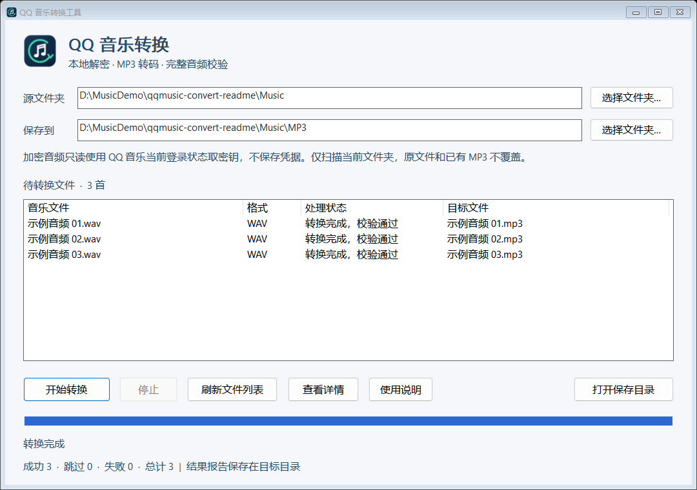

# QQ Music Convert

[English](README.en.md) | 简体中文


一个使用 Go 开发的 Windows 本地音频转换工具。提供原生图形界面，支持将 QQ 音乐
musicex V1 加密音频及常见普通音频转换为 MP3，并在输出前完成音频校验。

面向你有权访问的本地文件。本项目不提供音乐下载、账号登录、凭据导出或付费权限绕过功能，
也不是腾讯或 QQ 音乐的官方产品。

## 功能

- 单文件夹批量转换，可选择源目录和保存目录。
- 默认扫描 EXE 所在目录，保存到该目录下的 `MP3` 文件夹。
- 显示当前歌曲、处理阶段、总进度以及成功、跳过、失败数量。
- 支持停止转换、查看错误详情、打开输出目录和保存 JSON 结果报告。
- 原文件保持不变，已有 MP3 跳过，不覆盖。
- 支持窗口最大化、缩放，以及连续多层 `musicex` 尾部解析。
- 单个 EXE 内置转码组件，运行时无需安装 Python、Go、FFmpeg 或 WebView2。

## 界面预览



截图展示三段合成音频转换完成后的真实界面，使用演示路径和文件名。
可在顶部选择源文件夹与保存目录，在列表中查看每个文件的状态，并在底部查看总进度和转换结果。

## 运行要求

| 项目 | 要求 |
|---|---|
| 系统 | Windows 10 / 11，x64 |
| 加密音频 | 桌面版 QQ 音乐正在运行并已登录，当前账号有权访问相应资源 |
| 普通音频 | 不需要 QQ 音乐登录状态 |
| 存储 | EXE 约 23 MB；首次转换展开约 31 MB 组件缓存，另需音频临时文件和输出空间 |

程序未进行商业代码签名。如果系统提示未知发布者，请核对下载来源和 SHA-256，
不要关闭安全软件来运行程序。客户端更新可能影响自动密钥获取，不保证兼容所有版本。

## 快速开始

有发布版本时，从本仓库的 **Releases** 获取 Windows EXE 和校验文件；也可以按下文从源码构建。

1. 将 `qqmusic-convert.exe` 放进音乐文件夹，双击打开。
2. 确认源文件夹和保存目录，或点击“选择文件夹”更换路径。
3. 转换加密音频前，先打开 QQ 音乐并保持登录。
4. 点击“开始转换”，等待校验和转码完成。
5. 点击“打开保存目录”查看 MP3。失败条目可选中后点击“查看详情”。

打开程序只扫描文件，点击开始后才写出音频。只处理指定目录的直接子文件，不递归子目录。
手动编辑路径后，点击“刷新文件列表”。停止时会清理当前任务的临时音频，已完成结果保留。

## 支持格式

| 输入类型 | 格式 |
|---|---|
| 加密音频 | 带 musicex V1 尾部的 `.mflac`、`.mgg`、`.mmp4` |
| 普通音频 | `.flac`、`.wav`、`.ogg`、`.m4a`、`.aac`、`.opus`、`.wma`、`.mp3` |

非 MP3 输入转换为 320 kbps MP3；已经是 MP3 的输入在验证后复制，不重复有损编码。
同名多种格式会为非 MP3 来源追加格式后缀，例如 `歌曲 (mflac).mp3`。

不支持旧 QMC、其他音乐平台加密格式或未知的未来格式。MP3 是有损音频，原文件始终保留。

## 校验与隐私

- 转换前后核对原文件 SHA-256；发现文件变化时不发布结果。
- FLAC 含有效内置校验值时，核对全部 PCM 数据的 MD5 和样本数。
  解码警告只有在两项均匹配时才允许继续；这项校验支持 8 / 16 / 24 / 32 位 FLAC。
- 没有可用校验值的 FLAC 和其他格式，必须通过严格全曲解码。
- 输出 MP3 经格式识别和严格全曲解码后才发布，已有目标文件不替换。
- 每个加密资源分别请求匹配密钥；当前批次的认证信息仅在内存中复用。
- 只读访问 `QQMusic.exe`，不写进程内存、不注入代码、不自动提权。
- 仅向 QQ 音乐固定 HTTPS 接口发送必要的资源标识和认证信息，不上传音频文件。
- 登录令牌和歌曲密钥不写入配置、日志、报告或临时文件。

一首失败会记录原因并继续其他文件。报告包含路径、状态、错误和校验信息，不包含密钥。
提交 Issue 前请移除个人路径、账号信息和真实音频。已有输出被跳过不代表通过本次校验。

## 从源码构建

构建在 Windows 上进行，需要 Go 1.26+ 和包含 Bash 的 Git for Windows。
默认脚本核对固定源码与 LLVM-MinGW 工具链的哈希，自行构建 FFmpeg / FFprobe 和 LAME。
这些是开发依赖，不是最终 EXE 的额外运行依赖。首次构建需要较多下载和编译时间。

在项目根目录执行：

```powershell
& ".\scripts\build.ps1"
```

如果明确使用其他媒体构建，可指定路径并自行落实相应源码与许可。以下目录仅为示例：

```powershell
& ".\scripts\build.ps1" `
  -FFmpeg ".\tools\ffmpeg\bin\ffmpeg.exe" `
  -FFprobe ".\tools\ffmpeg\bin\ffprobe.exe"
```

脚本下载 Go 模块、生成内嵌媒体资源和 Logo、嵌入图标与 manifest，运行格式检查、
`go vet` 和测试，然后以 `CGO_ENABLED=0` 构建 Windows GUI EXE。
产物位于 `dist/`，包括 EXE、中文说明和 `SHA256.txt`。
首次构建需要联网获取 Go 模块及固定版本的图标资源构建工具。

媒体压缩资源、图标二进制和资源对象均由脚本生成，不需要提交到 Git。
不要只运行 `go build` 来构建一个缺少媒体组件或图标资源的干净检出目录。
替换 FFmpeg 构建时，也要更新组件版本、来源和许可记录。

## 测试与诊断

在构建脚本准备好资源后，可以重复执行：

```powershell
go test ./... -count=1
go vet ./...
```

竞态检查还需要原生 Windows GCC 或 LLVM/MinGW 编译器。设置 `CC` 后，
使用 `build.ps1 -Race`；该编译器不是程序运行依赖。

无界面诊断入口输出 JSON，任何转换失败时退出码为 1：

```powershell
& ".\dist\qqmusic-convert.exe" -convert ".\music" -output ".\mp3"
```

日常使用直接双击 EXE。回归测试使用合成数据，不需要真实账号或真实歌曲；
本地真实音频验证不作为公开测试夹具提交。

## 项目结构

```text
cmd/qqmusic-convert/   应用入口
cmd/package-media/    媒体资源打包
cmd/generate-logo/    Logo、PNG 和 ICO 生成
internal/audio/       musicex、QMC2 和 TEA
internal/qqmusic/     只读认证与资源密钥请求
internal/media/       组件缓存和转码进程
internal/convert/     目录规划、转换、校验与发布
internal/desktop/     原生 Win32 界面
docs/                 项目发布与维护说明
third_party/          媒体源码、工具链和补丁哈希清单
patches/              FFmpeg Windows 构建补丁
licenses/             第三方许可原文
scripts/              构建脚本
```

`build/`、`dist/` 和内嵌组件压缩资源是生成物，由 `.gitignore` 排除。
GitHub 同步步骤和发布前的文件检查见 [GitHub 同步指南](docs/GITHUB.md)。

## 版本记录

**1.1 · 2026-10-11**

- 修复缓存音频后追加另一资源的 `musicex` 尾部导致密钥选错的问题。
  逐层验证尾部，使用最内层原始资源，并排除全部尾部后解密。
- 保留 PCM 校验、样本数检查和 MP3 全曲解码标准。
- 加入应用 Logo、原生最大化和窗口缩放。

## 来源与许可

本项目原创 Go 代码、文档和原创 Logo 采用 [MIT 许可证](LICENSE)。
第三方组件保留各自许可，范围与版权见 [NOTICE.md](NOTICE.md) 和 [许可证说明](docs/LICENSING.md)。
项目 MIT 不会将内嵌 FFmpeg 或其他第三方组件重新许可为 MIT。

本版媒体组件从固定源码构建，唯一启用的外部编码库为 LAME。
发行页同时提供 Windows 程序、应用源码与媒体组件对应源码，包含构建补丁、脚本和版本记录。
详细范围见 [EXE 发行材料](docs/DISTRIBUTION.md) 和 [媒体组件构建](docs/MEDIA_BUILD.md)。

| 组件 | 来源与许可 |
|---|---|
| QMC2 / TEA 算法 | QM Unlock，固定提交 `c41a3e9affe67e01048d64fdd160a0002c913a30`，MIT |
| Go、golang.org/x/sys | BSD，原文见 `licenses/` |
| 内嵌 FFmpeg / FFprobe | 固定源码自构建的 FFmpeg 8.1.1，GPLv3 或后续版本 |
| LAME 3.100 | LGPLv2 或后续版本，静态链接在 FFmpeg 中 |

第三方许可与来源说明也嵌入 EXE，可通过“使用说明”按钮取得本地文本。
公开分发内嵌 FFmpeg 的 EXE 时，须按适用许可提供对应源码、构建资料和声明；
只附许可文件或上游源码网址不能作为已完成全部分发要求的证明。
详情以 FFmpeg 官方许可说明及组件的原始许可证为准。
